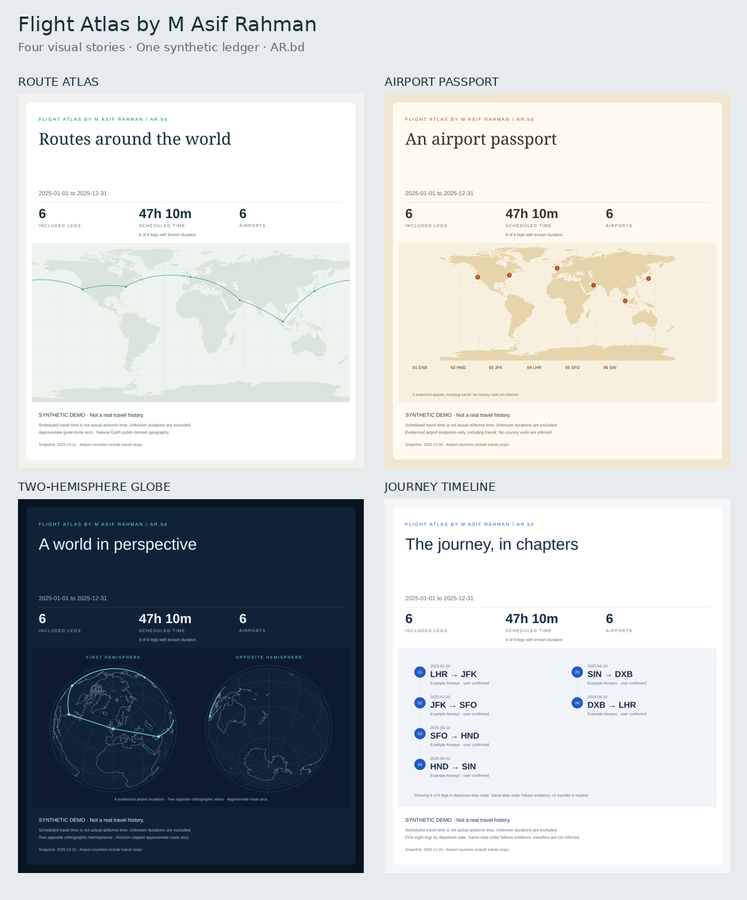

# Flight Atlas by M Asif Rahman

[AR.bd](https://AR.bd) · Original travel reports from your own evidence

**Your journeys, reconstructed from email. Your year, told through maps and data.**

Flight Atlas is a reusable AI skill that turns flight confirmations, itinerary changes and other authorized travel evidence into an annual, one-trip or custom-duration report. It combines geographic route maps, scheduled flight hours, travel analytics and an honest record of what is still missing.



## Start with your report

Flight Atlas asks you to choose two things before it starts:

| Report | Best for |
| --- | --- |
| **Annual** | A calendar year or year-to-date recap |
| **One-time trip** | A single journey, including its return or open-jaw ending |
| **Custom duration** | A date range, several years, or a comparison |

Then choose a **visualization layout**, not just a color:

| Layout | What changes |
| --- | --- |
| **Route Atlas** (`routes`) | A wide world map with great-circle flight connections |
| **Airport Pins / Airport Passport** (`points`) | A point-map footprint with airport labels, without route lines |
| **World Globe** (`globe`) | Orthographic hemispheres with geographic depth and horizon clipping |
| **Journey Ribbon / Timeline** (`journey`) | A chronological travel narrative rather than a map-led cover |

Choose colors separately: **Atlas**, **Midnight**, **Boarding Pass**, or **Executive**. Every layout works with every palette. All gallery examples use the same synthetic records, so the differences are composition and encoding, not altered numbers.

These original designs draw on established conventions from Flighty, Pin Traveler, TravelBoast, Polarsteps and Skratch. See [research and sources](references/design-research.md); no third-party artwork or product UI is copied.

If you already specify the dates and design, it gets straight to work. “Annual” describes the report period: it does not create a recurring task or subscription.

## Gallery and working examples

The previews below are original graphics built from one shared synthetic multi-region ledger, not the creator's flights. Download an HTML example and open it locally, or view the SVG cover directly:

| Graphic | Preview | Vector cover | Offline report |
| --- | --- | --- | --- |
| Route Atlas | [PNG](docs/previews/routes.png) | [SVG](docs/previews/routes.svg) | [HTML](docs/previews/routes.html) |
| Airport Pins | [PNG](docs/previews/points.png) | [SVG](docs/previews/points.svg) | [HTML](docs/previews/points.html) |
| World Globe | [PNG](docs/previews/globe.png) | [SVG](docs/previews/globe.svg) | [HTML](docs/previews/globe.html) |
| Journey Ribbon | [PNG](docs/previews/journey.png) | [SVG](docs/previews/journey.svg) | [HTML](docs/previews/journey.html) |

## What you get

- **Four distinct cover layouts**: route map, airport pin map, world globe and chronological journey ribbon.
- **Scheduled flight hours** using the advertised ticket duration or the dated schedule, adjusted for time zones.
- **Monthly and annual views**, airline mix, frequent directional routes, longest and shortest known scheduled legs.
- **A flight ledger** with evidence status for each included segment.
- **Every trip, start to finish**: flights grouped into trips from your home airport(s) and back, with dates, route, flights and hours for each.
- **Questions instead of guesses**: when a trip has an outbound but no return (or the other way round), it asks you about that exact flight, and you can answer in a word or send the e-ticket, boarding pass or a screenshot.
- **A gap audit** that distinguishes missing flights from trains, cars, airport transfers and trips spanning calendar years.
- **A full PDF report** (cover page, maps, charts, every trip and every flight) or just the cover image; offline HTML reports and standalone SVG covers too.

The skill is designed for more than a pretty map. It handles cancelled and missed flights, replacement tickets, codeshares, forwarded confirmations, unknown durations and incomplete inbox history. It never creates a return flight just to make the map look complete.

## Use it with your AI assistant

This repository contains the complete skill at its root. Use an assistant that supports folder-based skills, connected email search/read tools and Python code execution.

The `docs/` gallery and this README are for people browsing GitHub; the assistant doesn't need them. `scripts/package_skill.py` builds a clean copy with only the skill files (`SKILL.md`, `LICENSE`, `agents/`, `assets/`, `references/`, `scripts/`), about 0.7 MB zipped instead of 3 MB:

```bash
git clone https://github.com/Asif2BD/Flight-Atlas.git && cd Flight-Atlas
python3 scripts/package_skill.py          # writes dist/flight-atlas/ and dist/flight-atlas.zip
```

### Install in Claude (claude.ai, desktop and mobile apps)

1. Build `dist/flight-atlas.zip` with the command above. Use it rather than GitHub's "Download ZIP", which names the folder after the branch and adds the README.
2. In Claude, open **Settings** and find **Skills** (under Capabilities on most plans). Code execution needs to be on, because the skill runs its Python scripts.
3. Upload `flight-atlas.zip`, then switch the skill on.
4. Connect your email (for example Gmail) under Claude's connectors, or skip it and list your flights yourself.

Then ask: *"Use Flight Atlas to build my 2025 flight report."* Claude loads the skill when a request matches its description, so you don't need to name it every time. On Team and Enterprise plans an owner may need to allow custom skills first.

### Install in Claude Code

Copy the clean folder into a skills directory:

```bash
python3 scripts/package_skill.py --dest ~/.claude/skills    # every project on this computer
python3 scripts/package_skill.py --dest .claude/skills      # only the current project
```

Restart Claude Code (or start a new session) so it picks up the skill, then ask for a flight report or type `/flight-atlas`. Re-run with `--force` to update an existing copy. Keep your own ledgers and reports outside the skill folder.

### Other assistants (Codex, ChatGPT and others)

Install the same `dist/flight-atlas/` folder with your assistant's skill installer. `agents/openai.yaml` carries the display name and default prompt for OpenAI hosts. Follow your environment's skill-management guidance rather than overwriting an existing installation.

### Connect email

Connect the mailbox you want the assistant to read through its normal secure connection flow. If you haven't connected one, Flight Atlas asks you to, and in the same message asks your timeframe, design and any gaps in the year, so you can start without email by listing your flights yourself. Flight Atlas does not include mailbox credentials, run an email server, or grant access by itself. Tool availability and connection permissions depend on your assistant.

Try:

> Use Flight Atlas to help me choose a report period and design, then build my flight report from my connected email.

Or give it all the choices:

> Use Flight Atlas to create my 2025 annual report with the World Globe layout and Midnight colors. Calculate advertised flight hours and show any missing return segments separately.

> Create a one-time trip report for my Japan journey from June 4–18, 2025 with the Journey Ribbon layout and Boarding Pass colors. Separate trains from flights.

> Compare my flights from January 2023 through December 2025 with the Route Atlas layout and Executive colors. Flag differences in evidence coverage between years.

If your host supports skill invocation by name, use `/flight-atlas` (Claude Code) or `$flight-atlas` (Codex). Otherwise explicitly ask it to follow [SKILL.md](SKILL.md).

## Run the synthetic demo locally

The bundled scripts require **Python 3.10+** and use only the standard library. They do not access email or automatically parse PDF tickets. The assistant performs the evidence search and prepares a reviewed ledger; the scripts calculate and render that ledger.

```bash
mkdir -p output
python3 scripts/enrich.py assets/example-ledger.json --out output/ledger.json
python3 scripts/analyze.py output/ledger.json --out output/summary.json
python3 scripts/render_report.py output/summary.json \
  --out output/report.html --theme atlas --layout routes --cover output/cover.svg
python3 scripts/clarify.py output/summary.json        # questions about open trips, as a chat message
python3 scripts/export_pdf.py output/summary.json --out output/report.pdf
```

Open `output/report.html` in your browser. Change `--layout` to `points`, `globe` or `journey` to compare graphics. Independently change `--theme` to `midnight`, `boarding-pass` or `executive` to compare colors. The example is entirely synthetic, not the creator's travel history. The cover is an editable vector file. `export_pdf.py` builds the full report PDF with headless Chrome, Chromium or Edge, WeasyPrint or wkhtmltopdf, whichever is installed; without any of them it keeps the full HTML so you can print it from a browser. Inspect the pages before sharing.

To regenerate all four gallery reports from the same richer synthetic example:

```bash
python3 scripts/analyze.py assets/example-layout-ledger.json --out output/gallery-summary.json
for layout in routes points globe journey; do
  python3 scripts/render_report.py output/gallery-summary.json \
    --out "output/$layout.html" --layout "$layout" --theme atlas \
    --cover "output/$layout.svg"
done
```

This loop deliberately keeps the color identical to demonstrate structural differences. PNG export uses an SVG renderer such as Inkscape; no image-generation model is used for geographic data.

For your own data, follow the [ledger contract](references/data-contract.md), keep it in a private directory, then run the same commands. Write ticket times as printed (`departure_local`, `arrival_local`) and let `enrich.py` add airport coordinates, countries, time zones and DST-correct offsets from the bundled airport table; look up a code with `python3 scripts/airports.py DXB`. To read an exported email cheaply, `python3 scripts/trim_email.py message.eml` keeps only its itinerary lines. Do not commit personal travel records into this public repository.

## How the numbers work

**One row means one physical flight segment**, not one email, ticket or booking. The reporting window uses the local departure date. Future bookings, cancelled or missed flights, replaced records and other travelers are excluded from the historical headline totals.

**Scheduled time is not airborne time.** Advertised block duration includes scheduled gate-to-gate time. Actual flight time, layovers and ground transfers are not mixed into that total. Unknown durations stay unknown, and the report shows how many legs have usable timing.

**Evidence is graded.** A ticket or boarding pass does not prove boarding. The default reconstructed report distinguishes confirmed/user-confirmed records from strongly supported and itinerary-only records. A stricter confirmed-only mode is available.

**Times and places come from reference data, not memory.** A bundled table of 7,900+ IATA airports supplies coordinates, countries and IANA time zones; UTC offsets are computed with Python's time-zone database, so clock changes are handled and impossible or ambiguous times are flagged instead of guessed.

**Maps show approximate connections, not GPS tracks.** Great-circle arcs use verified airport coordinates and split correctly at the date line. Airport-country counts include transit airports; they are not a count of countries entered or visited.

A connected inbox cannot guarantee a complete travel history. Missing mail, inaccessible attachments, bookings held in another account and uncertain passenger identities remain visible limitations.

## Privacy by design

- Read only authorized sources. No messages are sent, bookings changed or email state changed as part of reconstruction.
- Keep the detailed evidence ledger private and separate from shareable reports.
- Exclude raw emails, booking references, ticket numbers, barcodes, passport details, loyalty identifiers and private mailbox links from public covers.
- Inspect free-text titles and notes before sharing; escaping HTML is not a secret detector.
- Publish or share travel history only when the person authorizes it.
- The repository contains generic code, public-domain map geometry and synthetic samples only.

## Files and extension points

```text
SKILL.md                    Assistant workflow and report/template selection
LICENSE                     MIT License
references/intake.md        Opening flow: connect email, or ask timeframe, design and gaps
agents/openai.yaml          Skill discovery metadata
scripts/airports.py         Bundled IATA airport lookup
scripts/enrich.py           Fills coordinates, countries, time zones and DST-correct offsets
scripts/trim_email.py       Keeps only itinerary lines from an exported email
scripts/analyze.py          Validation, inclusion, duration and analytics
scripts/render_report.py    Offline HTML, SVG maps, charts and covers
scripts/layouts.py          Airport Pins, World Globe and Journey Ribbon graphics
scripts/trips.py            Groups flights into trips and finds open outbound/return legs
scripts/clarify.py          Words the open-trip questions as one chat message
scripts/export_pdf.py       Full report PDF (cover page, trips, ledger) with any available engine
scripts/package_skill.py    Builds the clean installable folder and zip (no docs/)
scripts/test_*.py           Synthetic regression tests
references/                Evidence rules, data contract, designs and QA
assets/themes.json          Four ready-made visual themes
assets/world-land.geojson   Natural Earth geographic geometry
assets/airports.csv         IATA airport coordinates, countries and time zones (MIT, mwgg/Airports)
assets/example-ledger.json  Safe synthetic input
assets/template-preview.png Design gallery shown when choosing a layout
docs/previews/              GitHub gallery only; not part of the installed skill
```

Add a theme in `assets/themes.json`, or extend the schema with optional fields while preserving existing definitions. Potential future modules include regional covers, photo journals, calendar heatmaps, cabin mix and cost analytics. Spend, emissions and delay metrics need their own evidence and clear methodology; they are not guessed from the default ledger.

## Validate changes

```bash
python3 -B -m unittest discover -s scripts -p 'test_*.py' -v
```

Tests cover the airport table, DST conversion and gaps, email trimming, time-zone arithmetic, date-line routes, duplicate records, exclusions, missing durations, cross-year boundaries, ground-transfer explanations, privacy filtering and all four themes. Follow the [validation checklist](references/validation.md) for real reports, including visual inspection at desktop/mobile widths and after PDF export.

## Creator and attribution

**Flight Atlas by M Asif Rahman · [AR.bd](https://AR.bd).** Preserve this creator credit and website link in the skill, documentation, reports and previews. On personal reports and covers the credit is a small footer line ("Made with Flight Atlas by M Asif Rahman · AR.bd"), so people are comfortable sharing their own cover. Individual reports remain evidence-based reconstructions for their users, not travel records independently verified by the creator.

Coastlines: [Natural Earth](https://www.naturalearthdata.com/), public domain. See [map attribution](assets/MAP-LICENSE.md). Airport data: [mwgg/Airports](https://github.com/mwgg/Airports), MIT. See [airport data attribution](assets/AIRPORTS-LICENSE.md). Code and documentation are released under the [MIT License](LICENSE), © 2026 M Asif Rahman.
